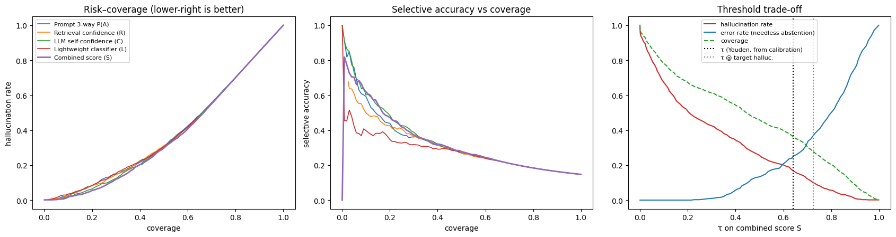
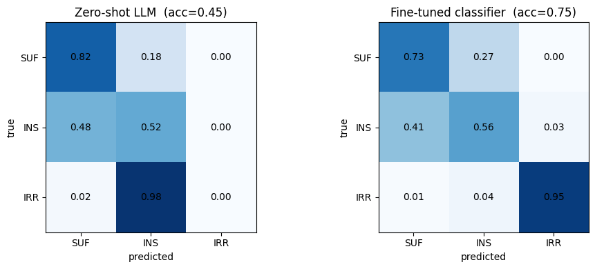

# Knowing When Not to Answer

Context-sufficiency-aware abstention for retrieval-augmented generation (RAG), evaluated on the multilingual NoMIRACL benchmark.

A RAG system retrieves passages and then answers, even when the passages don't contain the answer. This project checks whether estimating *context sufficiency* before generation (not just relevance) lets the system abstain more sensibly, and what it costs in coverage.

The full proposal and slides are in [`docs/`](http://docs/).

## What is compared

1. Standard RAG: always answers.  
2. Prompt abstention: the LLM is told to say "I don't know" if the context lacks the answer.  
3. Sufficiency estimation, using four different signals:  
   - the LLM's own 3-way judgement (sufficient / relevant but insufficient / irrelevant)  
   - retrieval confidence R (max cosine between query and passages, multilingual-e5)  
   - LLM self-confidence C (probability of "Yes" to "is the context enough to answer?")  
   - a lightweight classifier L (XLM-R fine-tuned on `question [SEP] passages`)  
4. Sufficiency-aware RAG: one of the signals decides whether to generate.  
5. Selective generation: a combined score `S = aR + bC + gL`; answer if `S >= tau`. Weights and tau are fitted on a calibration split.

Setup: Qwen2.5-1.5B-Instruct as generator and judge, six languages (English, Hindi, Bengali, Telugu, Arabic, Chinese), 5 passages per context, 1080 test items (60 queries per class per language).

## Repository layout

```
notebooks/context_sufficiency_rag.ipynb   full pipeline with outputs from the final run
results/                                  tables and figures from that run
data/                                     how to get the data (nothing is committed)
docs/                                     proposal and slides
requirements.txt
```

## How to run

NoMIRACL is downloaded automatically from the Hugging Face Hub, see [`data/README.md`](http://data/README.md).

**Kaggle** (what I used)

1. Create a new notebook and import `notebooks/context_sufficiency_rag.ipynb`.  
2. Set the accelerator to a GPU (T4 x2 or P100) and turn Internet on.  
3. Run all cells. The full run takes a few hours. Setting `QUICK_RUN = True` in the config cell runs a small version first.

**Locally**

```
pip install -r requirements.txt
jupyter notebook notebooks/context_sufficiency_rag.ipynb
```

A CUDA GPU is strongly recommended. Outputs are written to `outputs/` (or `/kaggle/working/outputs` on Kaggle).

## Results

Test set, thresholds chosen on the calibration split only. Hallucination rate \= share of insufficient/irrelevant items that were answered. Error rate \= share of sufficient items that were not answered.

| Method | Halluc. rate | Error rate | Coverage | Answering precision | Selective accuracy |
| :---- | :---- | :---- | :---- | :---- | :---- |
| Standard RAG | 1.000 | 0.000 | 1.000 | 0.333 | 0.147 |
| Prompt abstention | 0.151 | 0.408 | 0.298 | 0.661 | 0.360 |
| LLM 3-way label (answer if "sufficient") | 0.247 | 0.181 | 0.438 | 0.624 | 0.304 |
| Retrieval confidence (R) | 0.251 | 0.197 | 0.435 | 0.615 | 0.296 |
| LLM self-confidence (C) | 0.217 | 0.194 | 0.413 | 0.650 | 0.309 |
| Lightweight classifier (L) | 0.236 | 0.206 | 0.422 | 0.627 | 0.296 |
| Combined S (Youden tau) | 0.167 | 0.247 | 0.362 | 0.693 | 0.338 |
| Combined S (tau for \<= 10% halluc. on calibration) | 0.100 | 0.364 | 0.279 | 0.761 | 0.395 |

AUROC for separating sufficient from non-sufficient contexts: LLM 3-way 0.857, R 0.864, L 0.859, C 0.878, combined S 0.896. The fitted weights were (0.4, 0.3, 0.3) for (R, C, L).





What the numbers show:

- Standard RAG hallucinates on every insufficient item by construction, so the useful comparison is everything else.  
- Prompt abstention is cautious but blunt: low hallucination (0.151) at the price of abstaining on 41% of answerable questions.  
- Each single signal gives a similar AUROC (0.857 to 0.878). Combining them helps a little (0.896), and on the 10% operating point S has both lower hallucination (0.100 vs 0.151) and lower error rate (0.364 vs 0.408) than prompt abstention, at slightly lower coverage.  
- The 3-way task: the fine-tuned classifier reaches 0.75 accuracy against 0.45 for the zero-shot LLM, mostly because the LLM almost never predicts "irrelevant" (recall 0.00 vs 0.95). Separating sufficient from relevant-but-insufficient is hard for both (classifier F1 0.68 and 0.60). The classifier is about 5x faster per item (0.037 s vs 0.188 s) with 278M vs 1.5B parameters.  
- Per language (`results/per_language.csv`): prompt abstention over-abstains in Bengali (error rate 0.683), Telugu (0.667) and Hindi (0.517). S cuts that to 0.250, 0.583 and 0.233 while hallucination stays within a few points. Telugu stays hard for every method (coverage below 0.2). With 180 items per language, differences of a few points are within noise.  
- With a real dense retriever instead of fixed NoMIRACL contexts (`results/retriever_results.csv`), the thresholds from the oracle setting do not transfer well: S at the Youden threshold hallucinated on 0.451 of non-sufficient items, against 0.167 before. Thresholds need recalibration for the retrieval setting.

All metric tables are in [`results/`](http://results/).

## Limitations

- NoMIRACL only has relevant and non-relevant queries. The three classes are derived (see the data section of the notebook), so "relevant but insufficient" versus "irrelevant" is a construction, not a human annotation.  
- NoMIRACL has no gold answers. Correctness is judged by the same 1.5B model that generates the answers, so selective accuracy is only indicative.  
- The retrieval experiment uses a pooled mini-corpus built from the test passages, not the full MIRACL Wikipedia corpus. NoMIRACL's relevance labels are also incomplete, so some "insufficient" retrieved contexts may actually contain the answer.  
- One run, one seed, one model family.  
- The optional Sufficient Context evaluation was implemented but was not run.  
- In the small demo at the end of the notebook the classifier output is near zero for a clearly sufficient context, so L does not transfer well outside NoMIRACL-style text; the answer there comes from R and C.

## References

- Thakur et al. (2024). NoMIRACL: Knowing When You Don't Know. Findings of EMNLP.  
- Joren et al. (2025). Sufficient Context: A New Lens on RAG. ICLR.  
- Lewis et al. (2020). Retrieval-Augmented Generation for Knowledge-Intensive NLP Tasks. NeurIPS.  
- Asai et al. (2024). Self-RAG. ICLR.  
- Jeong et al. (2024). Adaptive-RAG. NAACL.  
- Kamalloo et al. (2023). MIRACL. TACL.